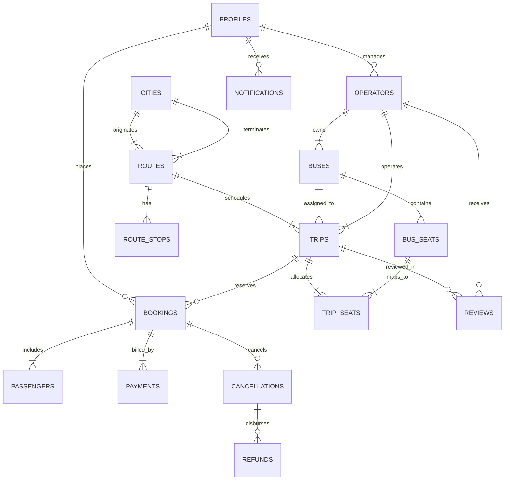

# BusGo Database Architecture & Relational Schema
## Comprehensive Specification for 17 PostgreSQL Relational Tables

---

### 1. Entity-Relationship Diagram (ERD)



---

### 2. Comprehensive Relational Tables Directory

| # | Table Name | Purpose | Primary Key | Critical Constraints / Foreign Keys |
|---|---|---|---|---|
| 1 | `profiles` | Extended user identity & role governance | `id` (UUID) | FK `auth.users(id)`, Role check (`customer`, `operator`, `admin`), Status check (`active`, `pending_approval`, `suspended`) |
| 2 | `operators` | Bus companies / partner fleet agencies | `id` (UUID) | FK `profiles(id)`, Unique `name`, Rating check (1.0 to 5.0) |
| 3 | `cities` | Indian departure & arrival hubs | `id` (UUID) | Unique `code` (e.g. `BLR`), Unique `name` |
| 4 | `buses` | Fleet vehicles and specifications | `id` (UUID) | FK `operators(id)`, Unique `registration_number`, `total_seats > 0` |
| 5 | `bus_seats` | Base physical seat layout template | `id` (UUID) | FK `buses(id)`, Unique `(bus_id, seat_number)`, Deck check (`lower`, `upper`) |
| 6 | `routes` | Interstate travel corridors | `id` (UUID) | FK `cities(origin_city_id)`, FK `cities(destination_city_id)`, Origin != Destination |
| 7 | `route_stops` | Pickup & drop locations with offsets | `id` (UUID) | FK `routes(id)`, FK `cities(id)`, Type (`boarding`, `dropping`) |
| 8 | `trips` | Scheduled journeys on specific dates | `id` (UUID) | FK `routes(id)`, FK `buses(id)`, FK `operators(id)`, `base_fare > 0` |
| 9 | `trip_seats` | Dynamic per-trip seat inventory & locks | `id` (UUID) | FK `trips(id)`, FK `bus_seats(id)`, Unique `(trip_id, seat_number)`, Status (`available`, `locked`, `booked`) |
| 10 | `bookings` | Customer reservations with PNR | `id` (UUID) | Unique `pnr`, FK `auth.users(id)`, FK `trips(id)`, Status (`pending`, `confirmed`, `cancelled`) |
| 11 | `passengers` | Passenger ticket details | `id` (UUID) | FK `bookings(id)`, FK `trip_seats(id)`, Gender check (`male`, `female`, `other`) |
| 12 | `payments` | Simulated transaction ledger | `id` (UUID) | Unique `transaction_ref`, FK `bookings(id)`, Status check (`DEMO_SUCCESS`, `DEMO_FAILED`) |
| 13 | `cancellations` | Cancellation requests and deductions | `id` (UUID) | FK `bookings(id)`, Unique `pnr`, FK `auth.users(cancelled_by_user_id)` |
| 14 | `refunds` | Simulated refund disbursements | `id` (UUID) | FK `cancellations(id)`, FK `bookings(id)`, Status (`DEMO_REFUNDED`, `FAILED`) |
| 15 | `reviews` | Verified passenger feedback | `id` (UUID) | FK `trips(id)`, FK `operators(id)`, FK `auth.users(id)`, Rating (1 to 5) |
| 16 | `coupons` | Promo codes & discounts | `id` (UUID) | Unique `code`, Type check (`percentage`, `fixed`) |
| 17 | `notifications` | User alerts & booking updates | `id` (UUID) | FK `auth.users(id)`, Type (`booking`, `trip`, `offer`, `system`) |

---

### 3. Concurrency Control & Double-Booking Prevention

#### Atomic Seat Locking (`lock_trip_seats` RPC)
```sql
SELECT public.lock_trip_seats(
  p_trip_id := '66666666-0001-0000-0000-000000000001',
  p_seat_ids := ARRAY['...']::UUID[],
  p_user_id := auth.uid(),
  p_session_id := 'session-...'
);
```
- Sets `lock_expires_at = NOW() + INTERVAL '10 minutes'`.
- Uses `FOR UPDATE` to lock database rows at the PostgreSQL storage engine level.
- Automatically handles lock expiration: a seat with an expired lock is safely treated as `available`.

#### Atomic Booking Transaction (`confirm_bus_booking` RPC)
```sql
SELECT public.confirm_bus_booking(
  p_trip_id := '...',
  p_seat_ids := ARRAY['...']::UUID[],
  p_user_id := auth.uid(),
  ...
);
```
- Runs in a single atomic database transaction:
  1. Re-verifies that all requested seats are still locked by the claiming caller and unexpired.
  2. Generates a collision-free PNR (`BG` + 6 random digits).
  3. Inserts `bookings` and `passengers`.
  4. Changes seat status to `booked`.
  5. Inserts simulated `payments` record marked `DEMO_SUCCESS`.
  6. Commits cleanly or rolls back 100% on any failure.

#### Tiered Cancellation & Instant Seat Release (`cancel_booking_rpc` RPC)
- **> 24 hours before departure**: 90% refund (10% fee).
- **12 to 24 hours before departure**: 75% refund (25% fee).
- **4 to 12 hours before departure**: 50% refund (50% fee).
- **< 4 hours before departure**: 0% refund (100% fee).
- Automatically resets `trip_seats` status back to `'available'`.

---

### 4. Running the Migration in Supabase Cloud

1. Log into your Supabase Dashboard: [https://supabase.com/dashboard](https://supabase.com/dashboard)
2. Open your project: **vwohebjuakqmwannykgh**
3. In the left navigation, click **SQL Editor**.
4. Open the combined all-in-one script located at:
   👉 [supabase/schema_all_in_one.sql](file:///c:/Users/madha/OneDrive/Desktop/pinkyyy/supabase/schema_all_in_one.sql)
5. Paste the contents into the SQL Editor and click **Run**.
6. All 17 tables, RLS policies, RPC stored procedures, and Indian seed data will be created in your cloud database!
